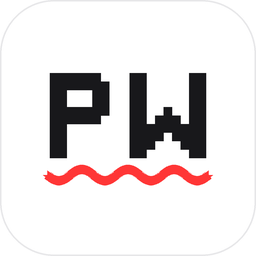

<div align="center">

  

  # ✦ Piahn Wijaya — Portfolio & UI Laboratory

  <p align="center">
    <strong>A high-performance personal portfolio, interactive UI component lab, native newsletter, and fullstack interactive platform.</strong>
  </p>

  <p align="center">
    <a href="https://github.com/Piahn/task-ICC-Portfolio-/blob/main/LICENSE.txt"></a>
    <a href="https://vitejs.dev/"></a>
    <a href="https://react.dev/"></a>
    <a href="https://tailwindcss.com/"></a>
    <a href="https://supabase.com/"></a>
    <a href="https://bun.sh/"></a>
  </p>

</div>

---

## 🌟 Overview

Welcome to the official repository for **Piahn Wijaya's Portfolio**. Built from the ground up with **Vite 6**, **React 18**, **Tailwind CSS v4**, and **Supabase**, this web platform serves not just as a static CV, but as a living engineering hub featuring interactive UI primitives, custom code snippets, a native Substack-style newsletter, and real-time visitor interactions.

---

## 🚀 Key Features

### 1. 🏠 Portfolio & Career Showcase (`/`, `/archive`)
- **Interactive Hero & Workstation**: High-fidelity personal branding, social links, Spotify track integrations, and client endorsements.
- **Projects & Timeline**: Detailed project case studies with screenshots, live preview links, and architectural notes.
- **GitHub Contribution Heatmap**: Real-time GitHub calendar integration pulling activity via GraphQL.

### 2. 📰 Native In-App Newsletter (`/newsletter`, `/newsletter/:slug`)
- **Substack-Style Experience**: Fully in-app reading experience without redirecting to external publication URLs.
- **Article Reader**: Rich MDX rendering with live Table of Contents (TOC), active bounding-box scroll spy, and reading progress indicators.
- **Social & Engagement**: Real-time reader likes, reader discussions, share drawers, and email subscription powered by Supabase.
- **Discovery Grid**: Tab-based feed filtering (`Top`, `Latest`, `Discussions`) and instant search.

### 3. 🧪 UI Component Laboratory (`/lab`, `/lab/:slug`)
- **Interactive UI Primitives**: Copy-pasteable, accessible component experiments built with Radix UI and Motion.
- **Showcased Components**:
  - Animated spring and smooth cursor followers.
  - Responsive vertical, horizontal, and solid step indicators/timelines.
  - Floating inputs, dynamic OTP inputs, number spinners, and note inputs.
  - Avatar groups, status indicators, and file uploaders.
  - Hierarchical default, icon, and lined tree views.

### 4. 🗂️ Developer Code Snippets Library (`/snippets`)
- **Curated Developer Snippets**: Collection of production-tested React hooks, TypeScript utilities, and Tailwind patterns.
- **Live Search & Category Filtering**: Instant search across titles, tags, and code blocks (`React & Hooks`, `TypeScript`, `Tailwind & CSS`, `Utilities`, `Next.js & API`).
- **Developer DX**: Dual-theme Shiki code highlighting (`github-dark` / `github-light`), line numbering, expandable code cards, and one-click copy with toast notifications.

### 5. 📝 Sticky Note Canvas (`/note`)
- **Collaborative Note Wall**: Interactive board where visitors can leave anonymous sticky notes.
- **OAuth Authentication**: Secure visitor login via GitHub OAuth with Supabase Row-Level Security (RLS).
- **Customization**: 9 pastel color options, character limits, and real-time grid positioning.

### 6. 📖 Interactive Guestbook (`/guestbook`)
- **Public Message Wall**: Leave messages, feedback, or greetings. Supports threaded replies and authenticated user badges.

### 7. 🍎 SwiftUI Component Gallery (`/swift`)
- **Native Apple UI in Browser**: Pixel-perfect SwiftUI-inspired component implementations running natively in React.

### 8. 👤 Personal Hub (`/personal`, `/bucket-list`)
- **Workstation Gear**: Desk setup, software preferences, terminal configurations, and daily developer stack.
- **Spotify Favorite Tracks**: Showcase of current music taste and curated tracks.

---

## 🛠️ Tech Stack

| Domain | Technologies |
| :--- | :--- |
| **Runtime & Tooling** | [Bun](https://bun.sh/), [Vite 6](https://vitejs.dev/), [TypeScript](https://www.typescriptlang.org/) |
| **Frontend Framework** | [React 18](https://react.dev/), [React Router 6](https://reactrouter.com/) |
| **Styling & Design System** | [Tailwind CSS v4](https://tailwindcss.com/) (`@tailwindcss/vite`), [CSS Variables](https://developer.mozilla.org/en-US/docs/Web/CSS/Using_CSS_custom_properties) |
| **Animations & Gestures** | [Motion (Framer Motion v12)](https://motion.dev/), [Lenis Smooth Scroll](https://lenis.darkroom.engineering/) |
| **Component Primitives** | [Radix UI](https://www.radix-ui.com/), [CMDK](https://cmdk.paco.me/), [Vaul](https://vaul.emilkowal.ski/), [Sonner](https://sonner.emilkowal.ski/) |
| **Content Engine** | [Velite](https://velite.js.org/) (Static MDX compiler with Rehype & Remark plugins) |
| **Syntax Highlighting** | [Shiki](https://shiki.style/) dual-theme engine (`github-dark` & `github-light`) |
| **Backend & Database** | [Supabase](https://supabase.com/) (PostgreSQL, Row Level Security, Auth OAuth, Realtime) |
| **State & Data Fetching** | [TanStack Query v5](https://tanstack.com/query/latest) (React Query) |
| **Icons** | [Phosphor Icons (`react-icons/pi`)](https://phosphoricons.com/), [Lucide React](https://lucide.dev/) |

---

## 📁 Project Structure

```text
salmoon/
├── action/              # Supabase server actions (content, guestbook, note)
├── components/          # Reusable UI component library
│   ├── form/            # Form components (note, contact)
│   ├── lab/             # UI Component Lab implementations
│   ├── motion/          # Animation wrappers & transitions
│   ├── newsletter/      # Newsletter reader & feed components
│   ├── provider/        # Context providers (smooth scroll, theme)
│   ├── shared/          # Shared components (footer, code viewer, TOC, header)
│   ├── snippet/         # Snippet card & search components
│   └── ui/              # Radix UI primitives & styled widgets
├── content/             # Markdown & MDX content files
│   ├── newsletter/      # Newsletter articles (.mdx)
│   ├── post/            # Blog posts (.mdx)
│   ├── project/         # Project case studies (.mdx)
│   └── swift/           # SwiftUI showcases (.mdx)
├── hooks/               # Custom React hooks
├── lib/                 # Utilities, static data, and site configuration
│   ├── config.ts        # Author info, SEO, and social navigation
│   ├── constants.ts     # Tech stack, gear, client data
│   ├── snippets-data.ts # Snippets library registry
│   └── utils.ts         # cn() helper
├── mutation/            # TanStack Query mutations (auth, note, content)
├── pages/               # React Router page views
│   ├── archive.tsx      # Portfolio archive
│   ├── guestbook.tsx    # Visitor guestbook
│   ├── home.tsx         # Home page
│   ├── lab.tsx          # Component laboratory
│   ├── newsletter.tsx   # Newsletter feed & detail reader
│   ├── note.tsx         # Sticky note canvas
│   ├── personal.tsx     # Workstation & personal hub
│   └── snippets.tsx     # Developer code snippets
├── public/              # Static assets (PW Favicons, fonts, images)
├── query/               # TanStack Query query functions & API hooks
├── styles/              # Global CSS & Tailwind v4 theme configuration
├── types/               # TypeScript type definitions
├── SETUP.md             # Detailed installation and database setup guide
├── vercel.json          # SPA rewrite configuration for Vercel deployment
└── vite.config.ts       # Vite bundler configuration
```

---

## ⚡ Getting Started

### Prerequisites

Ensure you have one of the following installed:
- **[Bun](https://bun.sh/)** (`>= 1.0.0`) *(Recommended for fastest builds)*
- **Node.js** (`>= 18.0.0`) & npm / pnpm

### 1. Clone the Repository

```bash
git clone https://github.com/Piahn/task-ICC-Portfolio-.git
cd task-ICC-Portfolio-
```

### 2. Install Dependencies

```bash
bun install
# or: npm install
```

### 3. Environment Variables

Create a `.env` file in the root directory:

```bash
cp .env.example .env
```

Configure the environment variables:

```env
# Application Base URL
NEXT_PUBLIC_BASE_URL=http://localhost:3002

# Supabase Configuration (For Guestbook, Sticky Note, Newsletter & Auth)
NEXT_PUBLIC_SUPABASE_URL=https://your-project.supabase.co
NEXT_PUBLIC_SUPABASE_ANON_KEY=your-supabase-anon-key

# GitHub Token (For Contribution Heatmap Calendar)
NEXT_PUBLIC_GITHUB_TOKEN=ghp_your_github_personal_access_token
```

> **Note**: For detailed Supabase SQL schema migrations and GitHub OAuth configuration, see [SETUP.md](SETUP.md).

### 4. Run Locally

```bash
# Start both Velite content compiler and Vite dev server
bun run dev
```

Open [http://localhost:3002](http://localhost:3002) in your browser.

### 5. Build for Production

```bash
bun run build
```

This compiles MDX content with Velite and produces an optimized production bundle in `dist/`.

---

## 🌐 Deployment to Vercel

This repository includes a pre-configured [`vercel.json`](vercel.json) with Single-Page Application (SPA) rewrite rules to guarantee error-free direct route navigation.

### Steps to Deploy:
1. Push your code to GitHub:
   ```bash
   git push -u origin main
   ```
2. Go to the [Vercel Dashboard](https://vercel.com/new) and click **Add New Project**.
3. Import the `task-ICC-Portfolio-` repository.
4. Add your Environment Variables (`NEXT_PUBLIC_SUPABASE_URL`, `NEXT_PUBLIC_SUPABASE_ANON_KEY`, `NEXT_PUBLIC_GITHUB_TOKEN`).
5. Click **Deploy**. Vercel will automatically build with Bun/Vite and provide a global CDN deployment with CI/CD.

---

## 📄 License

This project is open-source and available under the [MIT License](LICENSE.txt).

---

<div align="center">
  <p>Crafted with precision by <a href="https://github.com/Piahn"><strong>Piahn Wijaya</strong></a></p>
  <p><em>"When creativity meets perfection, you get me."</em></p>
</div>
